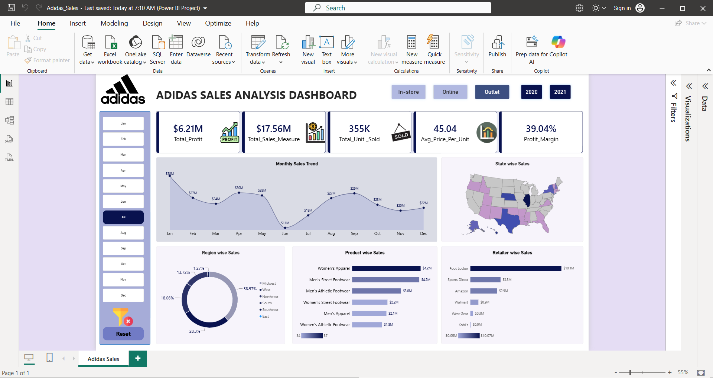

# Adidas US Sales Analysis Dashboard 📊

## 📌 About the Project
This project analyzes Adidas US sales data using Microsoft Power BI. It provides insights into sales performance, profitability, product categories, retailers, regions, and sales channels through an interactive dashboard.

## 🛠️ Tools Used
- Power BI
- Power Query
- DAX
- Microsoft Excel

## 📈 Key Performance Indicators (KPIs)
- Total Sales
- Total Profit
- Total Units Sold
- Average Price Per Unit
- Profit Margin

## 📊 Dashboard Visualizations
- Monthly Sales Trend
- State-wise Sales Analysis
- Region-wise Sales Analysis
- Product-wise Sales Analysis
- Retailer-wise Sales Analysis

## 🎛️ Interactive Filters
- Month
- Sales Method (In-store, Online, Outlet)
- Year (2020, 2021)

## 🎯 Project Objectives
- Analyze overall sales and profitability.
- Identify top-performing products.
- Compare retailer performance.
- Understand regional sales distribution.
- Track monthly sales trends.
- Compare different sales channels.

## 💡 Business Value
The dashboard helps understand sales performance and profitability, identify business trends, and support data-driven decision-making.

---

## 📊 Dashboard Preview

